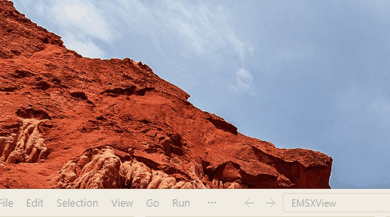

# 休息提醒 · Relaxation Reminder

> 一个会在鼠标旁慢慢变大的 Windows 11 休息提醒。到点提醒，真正离开键鼠才开始休息倒计时；轻量常驻、不抢焦点，不打断工作节奏。

[](https://github.com/HRLoveFun/relaxation-reminder/releases)
[](#系统要求)
[](LICENSE)

**关键词：** Windows 11 休息提醒 · 久坐提醒 · 护眼提醒 · 定时休息 · 番茄钟替代 · 轻量常驻 · 托盘工具 · 开机自启 · 自定义形象 · GIF 动图

[下载最新版](https://github.com/HRLoveFun/relaxation-reminder/releases/latest) · [功能](#功能) · [快速开始](#快速开始) · [使用说明](#使用说明) · [配置](#配置) · [常见问题](#常见问题)



## 为什么需要它

久坐、长时间盯屏幕时，普通的通知弹窗很容易被忽略：看到了，点掉，继续工作。这个工具换了一种提醒方式：

- **提醒会“长大”**：窗口从鼠标位置出现，60 秒内指数扩大到工作区面积的 30%，持续占据视野，直到你真正休息或手动关闭。
- **只有离开键鼠才算休息**：键鼠空闲满设定阈值（默认 10 秒）才开始休息倒计时；中途回来操作，倒计时暂停，再次离开后继续。
- **不抢键盘焦点**：提醒窗口置顶但不会抢走输入焦点，正在打字时不会打断输入。
- **轻量常驻**：单文件 exe 约 240 KB，空闲内存约 17 MB，无第三方运行时、无广告、无联网请求。

适合需要长时间坐在电脑前工作、学习、写代码，希望被“温和但无法忽略”地提醒起来活动一下的人。

## 功能

- **定时休息提醒**：按设定间隔弹出提醒，间隔从本次提醒最终消失后开始计算。
- **鼠标位置出现 + 指数扩大**：初始 320×320（按 DPI 缩放），面积按指数曲线增长，60 秒达到鼠标所在显示器工作区的 30% 后保持。
- **智能休息判定**：键鼠无输入满 `idle_threshold_seconds`（默认 10 秒）判定开始休息，启动 5 分钟休息倒计时；期间有输入则暂停，再次空闲后继续。
- **延后一次**：每次提醒可延后一次，默认 5 分钟；重新弹出后回到初始尺寸，延后按钮置灰。
- **手动关闭**：关闭前二次确认，并提示下次提醒时间。
- **托盘常驻**：支持“立即休息”、设置、选择形象、恢复默认形象、开机自启开关和退出。
- **开机自启**：默认开启，可在托盘菜单关闭；每次启动按当前 exe 路径自动修复自启项。
- **自定义形象**：支持 PNG、JPEG、BMP、GIF（含动画），未设置或加载失败时回退默认卡通方块。
- **即时生效设置**：提醒间隔、休息时长、延后时长使用拖动条，显示名称所见即所得，没有“保存/取消”。
- **异常恢复**：休眠唤醒、锁屏恢复后若已超过提醒时间则立即提醒一次；睡眠期间不误计休息时间。
- **单实例**：重复启动会唤起已运行实例的设置面板，不会产生多个托盘图标。

## 它是怎么工作的

1. 启动后常驻托盘，显示数秒“休息提醒已启动”提示。
2. 等待 `reminder_interval_minutes`（默认 30 分钟）后，提醒窗口从鼠标位置弹出并开始扩大。
3. 如果你一直在使用键鼠，窗口继续扩大并停留在 30% 工作区大小，不会自动消失。
4. 键鼠无输入满 10 秒，判定你开始休息，启动 5 分钟倒计时；窗口仍按原曲线扩大。
5. 倒计时期间回来操作，倒计时暂停；再次离开 10 秒后从暂停处继续。
6. 倒计时结束或手动关闭后，窗口消失，重新等待 30 分钟后再提醒。

> 延后会使下一次提醒整体顺延：下一次计时从本次提醒“最终消失”后开始。

## 快速开始

1. 打开 [Releases](https://github.com/HRLoveFun/relaxation-reminder/releases/latest)，下载 `RelaxationReminder-Setup-0.11.25.0.exe`。
2. 双击安装。安装为当前用户，无需管理员权限，默认目录 `%LOCALAPPDATA%\Programs\RelaxationReminder`。
3. 如果 Windows 显示 SmartScreen 提示，点击“更多信息”→“仍要运行”（安装包未做代码签名）。
4. 安装完成后程序会自动启动，并常驻系统托盘。
5. 想立刻看效果：右键托盘图标 → **立即休息**。
6. 想修改间隔：提醒窗口左下角“设置”，或右键托盘图标 → **设置**。

安装完成后默认每 30 分钟提醒一次，休息 5 分钟，延后 5 分钟，键鼠空闲 10 秒判定为开始休息。

## 使用说明

### 提醒窗口

| 操作 | 说明 |
|---|---|
| **延后** | 二次确认后关闭当前窗口，`snooze_duration_minutes`（默认 5 分钟）后重新弹出；每次提醒只能延后一次，重新弹出后按钮置灰。 |
| **关闭** | 二次确认后立即结束本次提醒，并从现在开始重新等待 `reminder_interval_minutes`。 |
| **设置** | 打开参数面板；面板独立置顶，不随提醒窗口消失。 |
| 等待休息 | 键鼠空闲满阈值后自动进入休息倒计时，倒计时结束窗口自动消失。 |

### 托盘菜单

| 菜单项 | 作用 |
|---|---|
| **设置** | 打开参数面板（左键双击托盘图标也可）。 |
| **立即休息** | 立即弹出提醒窗口；如果提醒已在显示，则不会重置尺寸或计时。 |
| **选择形象图片** | 选择本地 PNG/JPEG/BMP/GIF 作为提醒形象。 |
| **恢复默认形象** | 删除自定义形象，回到默认卡通方块。 |
| **开机自启** | 勾选/取消开机自动启动，立即生效。 |
| **退出** | 退出程序；本次运行结束。 |

### 设置面板

所有修改即时生效并写入配置，没有“保存/取消”按钮。

| 项目 | 可选值 | 说明 |
|---|---|---|
| 提醒间隔 | 20 / 30 / 40 / 50 / 60 分钟 | 本次提醒最终消失到下一次提醒的等待时间。 |
| 休息时长 | 5 / 10 / 15 分钟 | 进入休息后需要保持空闲的时长。 |
| 延后时长 | 5 / 10 / 15 分钟 | 点击延后后重新弹出的等待时间。 |
| 显示名称 | 1–20 个字符 | 标题显示“{名称}，休息一下”；默认“芬宝”，为空或含控制字符时使用“牛马”。 |
| 恢复默认值 | — | 立即恢复 30/5/5 和“芬宝”；不改变空闲阈值与开机自启。 |

`idle_threshold_seconds`（空闲阈值，默认 10 秒）不在面板显示，只能通过配置文件修改，详见[配置](#配置)。

### 自定义形象

1. 右键托盘图标 → **选择形象图片**。
2. 选择 PNG、JPEG、BMP 或 GIF（支持动画 GIF）。
3. 图片会复制到 `%APPDATA%\RelaxationReminder\character`，之后启动自动加载。
4. 右键托盘 → **恢复默认形象** 可随时还原。

限制：单文件 ≤10 MB，解码后单帧 ≤1024×1024，动图 ≤500 帧。文件缺失、格式不支持或解码失败时自动回退默认方块。

### 开机自启与卸载

- 开机自启默认开启，可在托盘菜单关闭；程序每次启动会按当前 exe 路径重写 `HKCU\Software\Microsoft\Windows\CurrentVersion\Run\RelaxationReminder`。
- 从“设置 → 应用 → 已安装的应用”卸载即可。
- 卸载默认**保留** `%APPDATA%\RelaxationReminder`（配置与自定义形象），重装后继续生效；如需彻底清除，手动删除该目录。
- 覆盖安装会先请求正在运行的实例退出，再替换程序文件。

## 系统要求

- Windows 11 x64
- 无需管理员权限、无需安装 .NET / Visual C++ 运行库（静态链接 CRT）
- 安装包最低系统版本为 Windows 10 1809；开发与验收以 Windows 11 为准

## 配置

配置文件：`%APPDATA%\RelaxationReminder\config.ini`（UTF-16 LE，启动时缺失则自动创建）。

| 键 | 默认值 | 说明 |
|---|---|---|
| `reminder_interval_minutes` | 30 | 提醒间隔，1–1440；设置面板限制为 20–60 |
| `rest_duration_minutes` | 5 | 休息时长，1–1440；设置面板限制为 5/10/15 |
| `snooze_duration_minutes` | 5 | 延后时长，1–1440；设置面板限制为 5/10/15 |
| `idle_threshold_seconds` | 10 | 空闲判定阈值，1–3600；仅配置文件可改 |
| `autostart` | 1 | 是否开机自启，0/1 |
| `user_name` | 芬宝 | 显示名称，1–20 个字符；为空或含控制字符时使用“牛马” |
| `character_image_file` | 空 | 自定义形象文件名；仅文件名，不含路径 |

非法数值回退默认值。配置文件中的时间值若不在设置面板档位内，打开面板时会就近归入对应档位并保存。

## 从源码构建

环境：

- Windows 11 x64
- Visual Studio 2019（v142 工具集）与 Windows 10/11 SDK
- 安装“使用 C++ 的桌面开发”工作负载
- 生成安装包需要 [Inno Setup 6](https://jrsoftware.org/isdl.php)

```bat
build.bat           rem 构建 release exe
build.bat test      rem 构建测试版并运行状态机单元测试
build.bat installer rem 构建 release + 安装包
```

产物：

- `build\RelaxationReminder.exe`：单文件、静态 CRT、无第三方运行时依赖。
- `dist\RelaxationReminder-Setup-0.11.25.0.exe`：每用户安装包。

也提供 CMake 工程：

```bat
cmake -S . -B build-cmake -G "Visual Studio 16 2019" -A x64
cmake --build build-cmake --config Release
```

## 常见问题

**Windows 提示“Windows 已保护你的电脑”，无法安装？**
安装包未做代码签名。点击“更多信息”→“仍要运行”即可。

**为什么提醒窗口越来越大？**
这是设计的一部分：如果提醒被忽略，窗口会持续扩大以占据视野，最多到工作区面积的 30%。开始休息、延后或关闭后即停止。

**为什么休息倒计时不开始？**
需要键鼠完全无输入满 `idle_threshold_seconds`（默认 10 秒）。移动鼠标、按键都会暂停倒计时；再次空闲满 10 秒后继续。

**“延后”按钮为什么是灰的？**
每次提醒只能延后一次。重新弹出的窗口仍可正常休息或关闭。

**提醒太频繁/太少？**
打开设置面板调整“提醒间隔”（20–60 分钟），或直接修改配置文件的 `reminder_interval_minutes`。

**卸载后配置还在？**
这是有意保留的，方便重装后继续使用。彻底删除请移除 `%APPDATA%\RelaxationReminder`。

**支持 macOS / iOS 吗？**
当前只实现 Windows 11 桌面端，macOS 与 iOS 在规划中。

## 项目文档

- [AGENTS.md](AGENTS.md)：需求与功能定义
- [TECH_DESIGN.md](TECH_DESIGN.md)：技术方案、状态机、测量方法
- [PRODUCT_ASSESSMENT.md](PRODUCT_ASSESSMENT.md)：竞品与立项评估
- [Releases](https://github.com/HRLoveFun/relaxation-reminder/releases)：下载与更新日志

## 许可证

[MIT](LICENSE)
